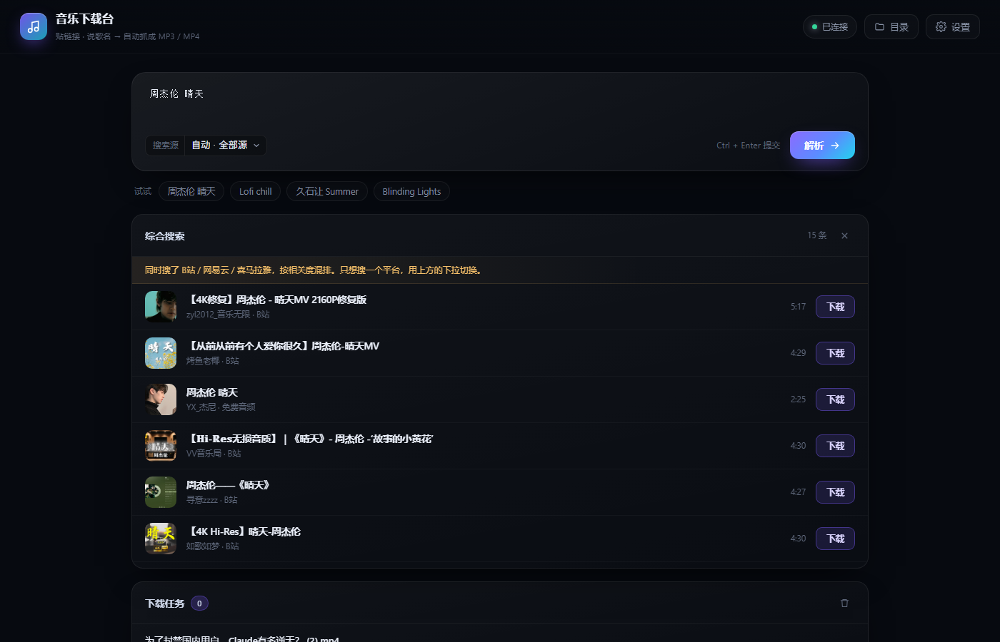
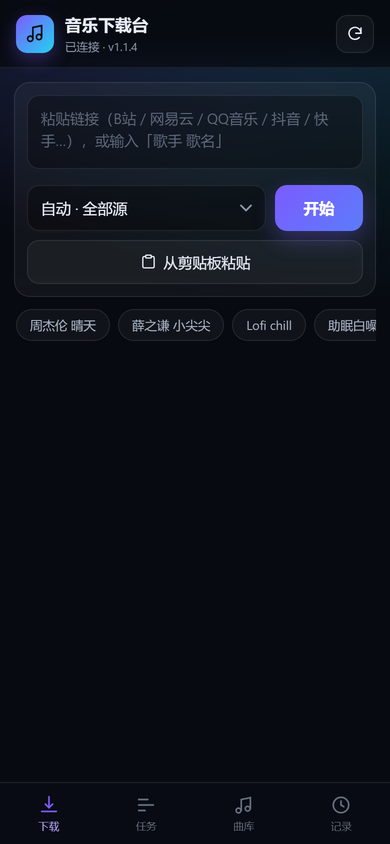
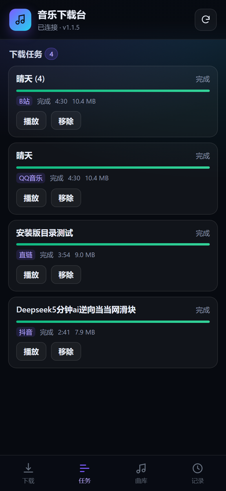
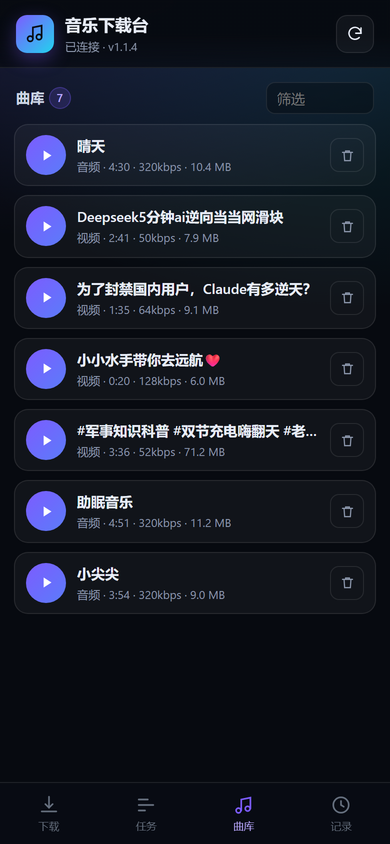

# 音乐下载台 · Music Desk

贴一个链接，或者说一句歌名，自动抓成 **MP3 / MP4**。

Windows 桌面软件 + 手机网页版。B站 / 网易云 / QQ音乐 / 酷狗 / 喜马拉雅 / 抖音 / 快手 / YouTube。



<p>



</p>

- **桌面软件版**：双击桌面的「音乐下载台」图标（已装到 `%LOCALAPPDATA%\MusicDesk`）
- **网页开发版**：`python server.py --port 8899`，浏览器开 http://127.0.0.1:8899/
- **手机版**：设置里勾「允许同一 Wi-Fi 下的手机访问」，重启后扫码打开（见 [手机端](#手机端)）

## 下载安装

不用装 Python，直接下打包好的：

**[⬇ 最新版 Releases](https://github.com/ixxgal/music-desk/releases/latest)**

解压后双击 `MusicDesk.exe` 就能用。想放到桌面，跑一下里面的 `安装到桌面.bat`。

> 手机端不用单独装 —— 它是电脑程序分出来的网页。手机和电脑连同一个 Wi-Fi，在电脑上开「允许手机访问」，用手机扫码打开，再点浏览器菜单里的「添加到主屏幕」，就会像 App 一样有独立图标、全屏打开。

---

## 能干什么

| 输入 | 会怎样 |
| --- | --- |
| 贴 B站 / 网易云 / 抖音 / 快手 / 喜马拉雅 / YouTube / 直链 | 自动认出平台，直接开始下 |
| 贴 QQ音乐 / 酷狗 的歌曲链接 | 先取歌名歌手，再去 B站 找同一首（这两家下载要会员，见下） |
| 贴抖音 / 快手的分享文案（「7.68 复制打开抖音…」） | 从文案里把链接抽出来 |
| 打「周杰伦 晴天」这类文字 | 在当前选中的搜索源里搜，点结果下载 |
| 一次贴多行链接 | 全部入队，并发 3 个 |
| 把本地音视频文件拖进来 | 转成 320k MP3 |
| 贴短链（`b23.tv` / `v.douyin.com` / `v.kuaishou.com` 等） | 先跟 302 还原成长链再判断平台 |

产出落在 `%LOCALAPPDATA%\MusicDesk\downloads`。音频写 ID3 标签并嵌封面（封面自动缩到 800px，不会把文件撑成两兆）。

---

## 平台支持情况

| 平台 | 搜索 | 直接下载 | 说明 |
| --- | --- | --- | --- |
| B站 | ✓ | ✓ 320k MP3 | 国内主力源，原曲大多有 Hi-Res 上传 |
| 网易云 | ✓ | △ 仅免费曲 | 版权曲的外链会返回一个 107KB 的 HTML 404 页，已加内容校验拦掉 |
| 喜马拉雅 | ✓ | ✓ MP3 | 走 `revision/play/tracks` 取流，VIP 曲目跳过 |
| QQ音乐 | ✓ | ✗ → 换源 | 元数据齐全（歌名/歌手/专辑/时长/封面），下载要登录 Cookie，实测 DPAPI 解不开 |
| 酷狗 | ✓ | ✗ → 换源 | 搜索能用，播放接口要 signature |
| 抖音 | ✗ | ✓ 去水印 MP4 | 无头浏览器拿 `aweme/detail` 响应，不需要登录 |
| 快手 | ✗ | ✓ MP4 | 必须有登录态，见下节 |
| YouTube | ✓ | ✓ | yt-dlp |
| 汽水音乐 | ✗ | ✗ | 接口全关，yt-dlp 也没有 extractor |

「换源」= 拿版权平台查到的准确歌名歌手，去 B站 匹配同一首。匹配打分：标题包含 +60、翻唱/伴奏/DJ 版 -60、时长差按 0.6/秒扣、播放量最高加 5。

---

## 快手为什么要登录

快手的坑不在「不给数据」，而在**失效作品不报 404，而是静默用推荐流顶替**——页面照常渲染、标题时长作者播放量全有，只是那是另一条视频。所以「能拿到数据」并不能证明「下对了片子」。

现在取直链的顺序（`browser_cdp.py` 的 `_fetch_kuaishou`）：

1. **⓪ 页面上 `<video>` 的 `src`** —— 里面带 `clientCacheKey=<作品id>_b.mp4`，这是硬指纹，推荐流顶替不了。命中即 `exact=True`。
2. ① 网络响应里按 `photoId` 或 caption 前 14 字对齐（`_ks_find_photo`）
3. ② 兜底：取含 `.mp4` 的最大响应体，正则抓 `photoUrl`

拿不到 `exact` 就**中止并报错**，宁可失败也不下错片。

登录态存在 `data\cdp-kuaishou`（Edge profile）。重新登录：

```powershell
# 关掉程序后，用独立 profile 开一个 Edge 应用窗口，扫码即可
msedge.exe --app=https://www.kuaishou.com/ --user-data-dir="%LOCALAPPDATA%\MusicDesk\data\cdp-kuaishou"
```

扫码后 cookie 自动落盘，无需其它操作。抖音不需要登录：它卡的是 `s_v_web_id`（前端 JS 自己算得出来），快手卡的是 `userId`/`passToken`（登录后才下发）。

---

## 换源的严格度：宁可下不成，也不下错

QQ 音乐 / 酷狗这类版权平台只提供元数据，真正下载时会去 B 站（再兜底网易云免费曲）找同曲。这个匹配是**严格模式**，下面任何一条不满足就直接放弃并报失败，不会随便塞一首给你：

| 检查 | 规则 |
| --- | --- |
| 名字 | 标题完全一致、或包含歌名、或歌手名出现在标题里 —— 三者至少占一样 |
| 时长 | 与原曲相差不超过 10%（且至少 12 秒）；差太多说明是别的版本 |
| 版本 | 命中「翻唱 / 伴奏 / DJ版 / 钢琴版 / 剪辑」等字样直接淘汰 |
| 综合分 | 累计分数低于 60 分不要 |

失败时错误信息会写清被否决的原因，例如：

```
自动换源也放弃了（B站 名字对不上「【UC的趣味测试32】测测你是不是微表情专家」；
网易云 名字对不上「四十岁的独白」）——宁可不下也不下错
```

代价是：冷门曲目、平台独占首发（B 站还没人搬）、名字完全对不上的，会直接失败而不是给个近似的结果。

---

## 界面

- **下载任务**：每条带平台徽章、进度、速度、剩余时间；失败的会写清原因。右上角「完成后自动隐藏」勾上后，已完成的任务自动从列表收起（记录仍在下载记录里，取消勾选即恢复）
- **本地曲库**：勾选多选 → 「下载所选」批量存到浏览器默认目录 / 「删除所选」批量删；顶部搜索框可过滤；曲库可自定义存放目录
- **下载记录**：所有完成或失败的任务都会留档（文件名、平台、时长、大小、时间、失败原因），最多保留 500 条，可手动清空
- **播放条**：音频和视频都能直接在里面播，播完自动下一首
- **刷新**：任务面板、曲库、下载记录各有独立刷新按钮

---

## 设置

点右上角「设置」：

| 项 | 默认 | 说明 |
| --- | --- | --- |
| 输出码率 | 320 kbps | 也可选 256 / 192 / 128 |
| 并发数 | 3 | 同时下载的任务数 |
| 下载位置 | 空 | 空 = 程序目录下的 `downloads`；可点「浏览」选任意文件夹 |
| 换目录时搬旧文件 | 关 | 勾上则把已有文件一起移到新目录（重名自动加序号） |
| 已完成任务保留天数 | 3 | 完成/失败的任务超过 N 天自动从列表删掉；填 `0` = 永不删除。只删任务记录，不动磁盘文件和下载记录 |
| 写 ID3 标签 | 开 | 标题/歌手/专辑/封面 |
| 嵌入封面 | 开 | 自动缩到 800px |
| 代理 | 空 | 形如 `http://127.0.0.1:7890` |
| 浏览器 Cookie | 空 | 形如 `edge` / `chrome`，给 yt-dlp 用 |
| 允许同一 Wi-Fi 下的手机访问 | 关 | 勾上后**重启软件**生效；下方会显示局域网地址和二维码，手机扫一下就能用 |

---

## 手机端

电脑上跑着，手机在同一个 Wi-Fi 里就能用。两条路，任选：

### 一、装成 App（Android）

下载 [Releases](https://github.com/ixxgal/music-desk/releases/latest) 里的 **`MusicDesk-<版本>.apk`**，传到手机点开安装（首次会提示「允许安装未知来源应用」）。

也可以用电脑版 zip 里附带的 `音乐下载台-手机.apk`。

装好后第一次打开是一张「连接电脑」的引导页：

1. 在电脑上开「允许同一 Wi-Fi 下的手机访问」（见下面第 1–3 步）
2. 把电脑设置里显示的地址填进去，形如 `192.168.1.5:8899`
3. 点「连接」——连上了就自动进主界面，地址记住，以后点图标直接进

> 这个 APK 是**壳**：界面和下载都在电脑上跑，手机是遥控器加播放器。内网地址每人不同，没法预置，所以第一次要手填一次。

### 二、用浏览器（免安装）

1. 电脑上点「设置」→ 勾选「允许同一 Wi-Fi 下的手机访问」→ 保存
2. 关掉软件重新打开（监听地址变了，必须重启）
3. 再打开设置，「手机访问」下面会出现二维码和地址，形如 `http://192.168.1.7:8899/m`
4. 手机扫码（或手输地址）打开
5. 想让它像个 App：浏览器菜单 → **添加到主屏幕**（支持 PWA，全屏无地址栏、有独立图标）

### 手机端能做什么

- 贴链接：从抖音/快手/B站 App 里「分享 → 复制链接」，整段粘进输入框就行，会自动识别平台并下成 mp3/mp4
- 搜歌：写「歌手 歌名」，从 B站/网易云/喜马拉雅混排结果里挑一条点下载
- 看任务：进度、速度、失败原因，能取消能移除
- 听曲库：直接在手机上播，音频视频都行，播完自动下一首
- 翻记录：成功和失败都留档

**注意**

- 手机端是电脑上这个进程在干活，电脑关了就用不了
- 手机在 `http://` 下读不了剪贴板（浏览器限制），点「从剪贴板粘贴」没反应就长按输入框手动粘贴。装 App 之后「粘贴」按钮走的是系统剪贴板，能正常用
- 别把地址发给外网的人 —— 同一 Wi-Fi 下的人都能访问，没有登录验证
- APK 是调试证书签的，够自己装；要上架商店得换成正式证书重新签

---

## 从源码跑起来

不想用打包好的 exe，想自己改代码：

```bash
git clone https://github.com/ixxgal/music-desk.git
cd music-desk
python -m pip install -r requirements.txt

# 起后端 + 网页（浏览器开 http://127.0.0.1:8899/）
python server.py --port 8899

# 或者起桌面窗口
python desktop.py
```

第一次跑 `server.py` 会自动在程序目录下建 `data/`（配置、任务记录、下载记录）和 `downloads/`（产出）。

**ffmpeg 不用自己装** —— `imageio-ffmpeg` 里带着一个带 libmp3lame 的二进制，`server.py` 启动时自己找。

**手机端**要监听 `0.0.0.0`：设置里勾「允许同一 Wi-Fi 下的手机访问」，或者 `python server.py --port 8899 --host 0.0.0.0`。

---

## 命令行工具

| 脚本 | 用途 |
| --- | --- |
| `server.py --port 8899` | 只起后端 + 网页 |
| `desktop.py` | 起后端 + 原生窗口（打包入口） |
| `selftest.py [port]` | 八条下载路径全跑一遍，用 ffmpeg 复检产物是不是真音频 |
| `browser_cdp.py <url>` | 单独解析抖音/快手直链，打印 JSON |
| `ks_hot_verify.py` | 从快手热榜捞真实作品 id 做验证样本 |
| `ks_check_installed.py` | 检查安装目录里的快手登录态还在不在 |
| `make_icon.py` / `make_splash.py` | 重新生成图标 / 闪屏 |
| `updater.py` | 自动更新的核心逻辑；直接 `python updater.py` 可打印当前检查结果 |
| `make_release.py` | 发新版：打包 → 压 zip → 写 `release/version.json` |
| `sync_github.py` | 把工作区同步到 GitHub（走 Git Data API，只传内容变了的文件） |

---

## 自动更新

**发布点在 OneDrive 根目录下**，不需要服务器、不需要开端口：

```
D:\OneDrive\MusicDesk-release\          ← OneDrive 同步的就是这个文件夹
    version.json                        ← 版本号 / 说明 / zip 文件名 / sha256
    MusicDesk-1.1.2.zip                 ← 整个程序目录
```

放在 OneDrive 根目录而不是项目目录里，是因为另一台电脑的工作区未必同步在 OneDrive，但 OneDrive 根目录一定是同步的。程序启动时会自己从环境变量里找 `%OneDrive%`，拼上 `MusicDesk-release`。

在任意一台电脑上发新版：

```powershell
python make_release.py --build --notes "这次改了什么"
```

OneDrive 同步完成后，**另一台电脑打开软件就会在顶部看到「发现新版本 v1.1.2」**，点「立即更新」→「重启并安装」，程序会自己关掉、替换文件、再打开，大约 10 秒。下载目录里的歌、`data` 里的设置和快手登录态都不会动。

细节：

- 检查时机：启动后 1.5 秒查一次，之后每 6 小时一次；设置面板里也有「立即检查」。
- 更新包下载后会校验 sha256，对不上直接丢弃，不会装上去。
- 替换用 robocopy 镜像模式，但排除 `data` 和 `downloads`，所以用户数据不受影响；装失败会写 `data\update-error.txt` 并自动重启旧版。
- 另一台电脑如果 OneDrive 路径不一样（比如 `C:\Users\xxx\OneDrive`），程序会自己从环境变量里找；实在找不到，就在「设置 → 更新源」里直接填 release 目录的绝对路径，或者填一个 `http://` 地址。
- `make_release.py` 默认只保留最新一个 zip，免得 OneDrive 里堆几百 MB 的旧包。

---

## 发版 / 重新打包

改版本号在 `updater.py` 第 35 行 `APP_VERSION`，然后一条命令搞定打包 + 发到 OneDrive：

```powershell
python make_release.py --build --notes "这次改了什么"
```

只需要重新装到本机时（不发版）：

```powershell
python -m PyInstaller --noconfirm --clean --onedir --windowed --name MusicDesk `
  --icon icon.ico --splash splash.png --add-data "web;web" --add-data "icon.ico;." `
  --hidden-import browser_cdp --hidden-import platforms --hidden-import video_search `
  --hidden-import updater `
  --collect-all webview --collect-all clr_loader --hidden-import clr `
  --exclude-module tkinter --exclude-module matplotlib --exclude-module pandas --exclude-module scipy `
  desktop.py

pwsh -NoProfile -ExecutionPolicy Bypass -File .\install.ps1
```

`install.ps1` 只覆盖程序文件，`data` 与 `downloads` 会保留。冷启动约 6–8 秒（PyInstaller 引导 + WebView2 内核初始化，有闪屏掩盖）。

---

## 常见问题

**下到的歌只有 1–2 MB、放不出来？**
旧版本有两个坑，都已修：① 网易云失效链接返回的 HTML 404 页被当成 MP3 存下来 → 现在校验 `Content-Type` 和文件头魔数；② 5906×5906 的封面把文件撑满 → 现在封面缩到 800px。另外 `run_job` 结尾会用 ffmpeg 复检时长，没音频直接删掉报错。

**双击 MP3 弹「选取应用」？**
这台机器的 `.mp3` 关联指向 `cloudmusic.mp3` 但 handler 没注册。用 PotPlayer 或在工具台里直接点 ▶ 播放。

**快手任务失败说「没返回这条作品的数据」？**
多半是那条作品真的没了（删除/转私密/限流）。快手对失效作品会静默返回推荐流内容，工具台为了防止下错片会主动中止。

**安装目录越装越大？**
`robocopy /E` 只加不删，旧 `_internal` 会累积。清理：

```powershell
$inst = "$env:LOCALAPPDATA\MusicDesk"
Remove-Item "$inst\_internal" -Recurse -Force
robocopy "dist\MusicDesk" $inst /E /XD data downloads /XF *.log
```

---

## 目录

```
music-desk/
├─ server.py          后端（HTTP + 各平台引擎 + 任务队列）
├─ desktop.py         桌面壳（pywebview + 单实例互斥量 + 深色标题栏）
├─ platforms.py       QQ音乐 / 酷狗 / 喜马拉雅 搜索与取流
├─ browser_cdp.py     抖音 / 快手 直链解析（CDP 驱动真实 Edge）
├─ web/               前端（index.html / app.js / style.css）
├─ data/              jobs.json、快手登录 profile
├─ downloads/         产物
└─ dist/MusicDesk/    打包产物
```